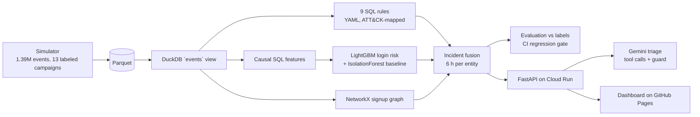

# AbuseRadar

**Counter-abuse detection and response for a smart-home device cloud.** ATT&CK-mapped
SQL detections, a LightGBM login-risk model, graph detection for fake-account rings,
alert-to-incident fusion, and Gemini incident triage behind a grounding guard, all
scored against labeled attack campaigns held out from training.

**Dashboard: https://nags-gk.github.io/abuseradar/** · **API: https://abuseradar-168677209514.us-central1.run.app** ([OpenAPI](https://abuseradar-168677209514.us-central1.run.app/docs)) ·
[Threat model](docs/threat-model.md) · [Detection catalog](docs/detections.md)

[](https://github.com/Nags-gk/abuseradar/actions/workflows/ci.yml)

## The problem

A consumer device cloud (thermostats, cameras, trackers) is attacked in ways that look
like normal traffic one event at a time: leaked-password stuffing spread over hundreds
of IPs, a phished password used once and correctly, a device credential copied to a
server, a script walking device IDs, a ring of fake accounts farming referral credit.
AbuseRadar finds these in the security event log, groups the alerts into incidents an
on-call engineer can act on, and drafts the response.

## Architecture



| Layer | What it catches | How |
|---|---|---|
| Rules (`rules/*.yml`) | Stuffing per IP and per ASN, spraying, impossible travel, takeover chain, device cloning, ID enumeration, signup bursts, unknown-username spikes | DuckDB SQL; each rule carries its ATT&CK technique, known false positives and response |
| ML (`abuseradar/ml.py`) | Login-level risk, including the low-and-slow variant the volume rules miss | 18 causal features; LightGBM trained on days 0–9 only; threshold from out-of-fold predictions; top contributing features attached to each alert |
| Graph (`abuseradar/graph.py`) | Fake-account rings that spread signups over days | Accounts, device fingerprints and IPs as nodes; components of 8+ accounts |
| Fusion (`abuseradar/incidents.py`) | Alert fatigue | Alerts on one entity within 6 h become one incident; high and critical incidents page |
| Triage (`abuseradar/triage.py`) | Slow first response | Gemini calls read-only tools (evidence, history, IP context, playbook search); a guard rejects uncited events or off-playbook actions and falls back to a deterministic answer |

## Results

From `results/eval.json`, produced by `python -m abuseradar.pipeline`: 4,000 accounts
over 21 days (1,394,470 events, 10,480 attacker events). Days 10–20 are held out; the
low-and-slow stuffing campaign C12 only appears there.

| Metric (held-out days 10–20) | Result |
|---|---:|
| Attack campaigns detected | **7 / 7** |
| Taken-over accounts flagged | **37 / 37**, median 0 min after the attacker's first successful login |
| Page precision (high/critical incidents) | **99.4%** |
| False pages per 1,000 accounts per day | **0.066** |
| Median time from first attacker event to first alert | **22.7 min** |
| Alerts folded into incidents | 1,670 alerts → 707 incidents |
| LightGBM login risk: PR-AUC / precision / recall | **0.996** / 99.3% / 93.7% |
| IsolationForest (no labels) PR-AUC, for comparison | 0.846 |

Per-campaign detail, including what each layer missed:

| Campaign | Variant | Rules | ML | Graph | First alert |
|---|---|---|---|---|---:|
| C11 credential stuffing | burst from hosting ASNs | R001 R002 R009, then R005 on takeovers | 100% of logins | | 1.2 min |
| C12 credential stuffing | 1 attempt per residential IP per hour, 60 h | **missed by every volume rule**; R005 fires only after each takeover (585 min) | 71.6% of logins | | 41.3 min |
| C13 password spray | one password, 25 IPs, 8 h | R003, R001 | 100% of logins | | 22.7 min |
| C14 phished takeover | correct password, first try | R005, R004 | 60% of logins | | 17.7 min |
| C15 device clone | serial reused from a hosting ASN | R006 | n/a | | 237.8 min |
| C16 API enumeration | sequential device IDs | R007 | n/a | | 5.8 min |
| C17 fake-account ring | 6 fingerprints, 10 IPs, 5 days | R008 | n/a | G1 | 324.6 min |

### LLM triage (`results/triage_eval.json`)

Gemini (`gemini-3.1-flash-lite`) triaged 20 pipeline incidents: 10 with attacker evidence and
10 false positives (mostly travellers caught by impossible travel). It confirmed **10/10** true
positives and called **4/10** false positives benign, for **70%** accuracy. Median latency was
1.8 s, and the guard rejected no answers in this run. The model leans toward "true positive", so
triage output is advisory and never closes an incident by itself.

Rule R004 (impossible travel) has 50% precision: travellers who log in from a new
phone abroad look the same as an attacker. It is set to low severity, so it opens a
ticket and does not page.

## How the detections got here (engineering notes)

1. **The first ML threshold paged on noise.** Choosing the threshold at 95% out-of-fold
   precision gave 120 false incidents in the test window, all single logins from travellers.
   Raising the target to 99% cut false incidents to 0.75 per 1,000 accounts per day while
   keeping every campaign detected.
2. **The scoring API disagreed with training.** An API test showed a user's ordinary
   home login scoring as a takeover. The online scorer only loaded the last 24 hours, so
   "network seen before" and "device seen before" were always 0. It now loads each
   scored account's full history, and the test pins the behaviour.
3. **An empty field became a feature.** Logins posted without a password hash all
   shared the empty string, which the spraying feature counted as one password across
   many accounts. Empty hashes now score 0 for that feature.
4. **The simulator was not reproducible.** Travellers were drawn from a Python `set`,
   whose order changes with hash randomization, so results shifted between runs. It now
   iterates a sorted list, and a test asserts byte-identical output for a fixed seed.

5. **The first LLM triage run never reached the model.** The SDK deep-copies its tool list,
   and bound methods dragged the DuckDB connection with them. Every call errored, and the
   guard fell back to the deterministic answer, so the run measured nothing. Tools are now
   plain closures.
6. **A small model skipped its tools and called everything a true positive** (50%
   accuracy, no false positive recognized). Retrieval is now deterministic: the service
   fetches evidence, 24 h of history before and after the incident, IP context and
   playbooks, and the guard requires a retrieved playbook and at least one action. The
   post-incident window raised accuracy to 70%: travellers do not change MFA or email
   afterwards, attackers do.

## Live demo

The dashboard on GitHub Pages replays the evaluation, and its **Run AI triage** button calls the live API on
Google Cloud Run (https://abuseradar-168677209514.us-central1.run.app, us-central1, max 1 instance, $5 budget alert, Gemini key in Secret Manager
behind a dedicated service account). Call it directly:

| Method | Path | |
|---|---|---|
| GET | `/v1/summary` | evaluation summary |
| GET | `/v1/incidents?severity=&attack=&limit=` | incident list |
| GET | `/v1/incidents/{id}` | one incident with evidence IDs |
| POST | `/v1/incidents/{id}/triage` | Gemini triage (3 per minute per client) |
| POST | `/v1/score` | score up to 200 login events against the last 24 h of traffic |
| GET | `/docs` | OpenAPI |

```bash
curl -s "https://abuseradar-168677209514.us-central1.run.app/v1/score" -H 'Content-Type: application/json' -d '{"events":[{"ts":"2026-09-21T23:00:00Z",
  "account_id":"u1","ip":"203.0.113.9","asn":64600,"asn_type":"hosting","country":"NL","lat":52.1,"lon":5.3,
  "device_fp":"fpx","user_agent":"python-requests/2.32","success":false,"pw_hash":"0a1b2c3d4e5f"}]}'
```

The API applies the controls from its own [threat model](docs/threat-model.md#part-2-abuseradar-api-public-demo):
per-client and global rate limits, input validation, a body-size cap, an allow-listed
CORS origin, security headers, generic errors, structured logs, a non-root container,
and the Gemini key in Secret Manager.

## Run it

```bash
pip install -r requirements.txt && pip install -e .
python -m abuseradar.pipeline        # simulate, detect, train, evaluate (about 1 minute)
python scripts/check_eval.py         # the CI quality gate
pytest -q                            # 40 tests
uvicorn abuseradar.api:app --port 8080
GEMINI_API_KEY=... uvicorn abuseradar.api:app --port 8080   # LLM triage instead of the deterministic path
```

CI runs lint, the full pipeline, the quality gate and the tests on every push, then
publishes the dashboard.

## Layout

```
abuseradar/  sim.py (simulator) store.py rules.py features.py ml.py graph.py incidents.py evaluate.py triage.py api.py pipeline.py
rules/       nine detections, one YAML file each
docs/        threat-model.md, detections.md (generated), playbooks.md (triage corpus), adr/
tests/       rule unit tests, causality, fusion, graph, guard, API security tests
web/         dashboard (GitHub Pages)
```

## Limitations

* All data is synthetic. The simulator encodes my assumptions about attacker and user
  behaviour, so the absolute numbers are optimistic; the held-out evasive campaign and
  the per-layer misses are the more honest signal.
* The dataset is 1.4M events. The SQL is written to run on BigQuery, but nothing here has
  been run at terabyte scale.
* The graph layer recomputes components in batch; a production version would update them
  incrementally on each signup.
* Rate limits are per Cloud Run instance, so the service is capped at one instance.

## License

MIT
