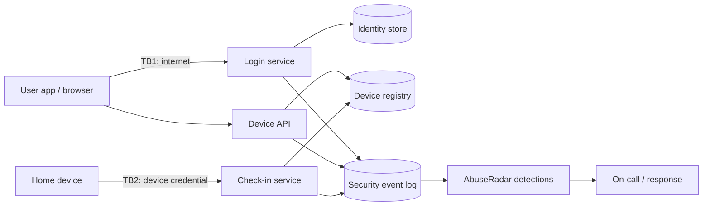

# Threat model

Two systems are in scope. Part 1 is the smart-home device cloud that AbuseRadar
defends; its abuse cases drove which detections were built. Part 2 is the AbuseRadar
API itself, which is public and so needs its own controls. Method: data-flow diagram,
STRIDE per element, then abuse cases ranked by likelihood x impact. Each threat
records whether its control is **implemented**, **detected** (by a named rule), or
only **recommended**.

## Part 1: Smart-home device cloud

### System
Users sign in from the mobile app or web to manage paired devices (thermostats,
cameras, trackers). Devices authenticate with a per-device credential and check in
every 4 hours. A device API lets the app read device state by device ID. New users
can sign up and redeem a referral promo.

Trust boundaries: TB1 between the internet and every public endpoint; TB2 between a
device and the check-in service (the device credential is the only proof of identity).

### Assets
Account credentials and sessions; MFA and recovery email (control of these equals
control of the account); camera feeds and home presence data reachable through
paired devices; device credentials; promo budget.

### STRIDE

| # | Element | STRIDE | Threat | Control | Status |
|---|---|---|---|---|---|
| 1 | Login service | Spoofing | Credential stuffing with leaked combo lists | Per-IP and per-ASN failure rules, unknown-username spike, ML risk score | Detected: R001, R002, R009, ML1 |
| 2 | Login service | Spoofing | Password spraying one common password across accounts | Keyed hash of attempted password, cross-account rule | Detected: R003 |
| 3 | Login service | Spoofing | Phished credentials used once, correctly, from a new network | Takeover-chain rule, impossible travel, ML on new network + device | Detected: R004, R005, ML1 |
| 4 | Identity store | Tampering | Attacker changes MFA and recovery email after takeover | Re-authentication for MFA/email change; alert on change after risky login | Detected: R005. Recommended: require the old factor for MFA changes |
| 5 | Check-in service | Spoofing | Cloned device identity checks in from attacker infrastructure | One-network-per-device rule | Detected: R006. Recommended: hardware-bound keys (attestation) so credentials cannot be copied |
| 6 | Device API | Information disclosure | Enumerating sequential device IDs to find devices | 4xx-ratio enumeration rule | Detected: R007. Recommended: unguessable device IDs; authorization check on every read |
| 7 | Signup / promo | Repudiation, abuse | Fake-account rings farming referral credits | Fingerprint burst rule, graph components | Detected: R008, G1. Recommended: hold payouts until accounts show organic use |
| 8 | Login service | Denial of service | Stuffing volume degrading login for real users | Edge rate limits per IP and ASN | Recommended |
| 9 | Security event log | Repudiation | Missing fields make incidents impossible to reconstruct | Log schema below is required on every auth and device event | Implemented in the simulator schema |
| 10 | Session tokens | Elevation of privilege | Stolen session reused from a new network | Bind sessions to device fingerprint; revoke on takeover | Recommended (playbook action A4) |

### Logging requirements (what the detections depend on)
Every login, check-in, account change and API call must log: timestamp, event type,
account, source IP and ASN, device fingerprint, user agent, result, and for logins a
short keyed hash of the attempted password. Without the ASN, R002 cannot see
distributed stuffing; without the keyed hash, password spraying is invisible; without
the device fingerprint, R004 cannot suppress VPN users and R005 loses its second
signal.

### Abuse cases ranked

| Abuse case | Likelihood | Impact | Detection coverage |
|---|---|---|---|
| Credential stuffing leading to takeover | High | High | Volume rules plus takeover chain; low-and-slow variant caught by ML and R005 |
| Phished takeover then device pairing (stalkerware risk) | Medium | Critical | R005 (critical) and R004 |
| Cloned device identity | Low | High | R006 |
| Device ID enumeration | Medium | Medium | R007; the real fix is unguessable IDs |
| Fake-account ring | Medium | Medium | R008 and G1 |

## Part 2: AbuseRadar API (public demo)

| # | Threat | Control | Status |
|---|---|---|---|
| 1 | Flooding the API or burning the Gemini quota | Token bucket per client IP (60/min), triage 3/min per IP, triage daily cap, cached triage results, Cloud Run max instances | Implemented |
| 2 | Spoofing X-Forwarded-For to dodge rate limits | Use the right-most hop that Cloud Run's front end appends | Implemented |
| 3 | Injection through query parameters or IDs | Incident IDs matched against `^INC-\d{5}$`; DuckDB queries use bound parameters; Pydantic validation on every scored event | Implemented, tested |
| 4 | Oversized request bodies | 64 KB cap and 200 events per scoring request | Implemented, tested |
| 5 | Prompt injection through log fields reaching the LLM | Tools are read-only; the guard rejects answers citing events or actions not returned by tools; deterministic fallback | Implemented, tested |
| 6 | Cross-origin abuse from other sites | CORS allows only the dashboard origin | Implemented, tested |
| 7 | Information disclosure via errors | Generic error bodies, no server header, request IDs for correlation | Implemented |
| 8 | Secret exposure | Gemini key held in Secret Manager, never in the image or repo | Implemented at deploy |
| 9 | Container compromise | Non-root user, slim image, no shell tooling added | Implemented |

Residual risk: rate limits are per instance, so they hold only while the service runs
one instance; scaling out would need a shared store such as Memorystore.
